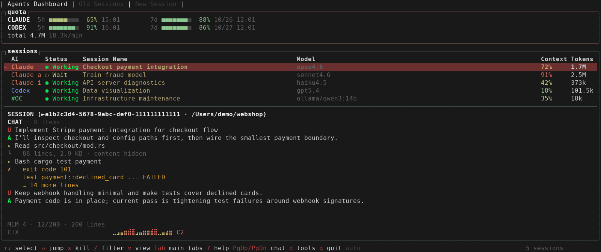
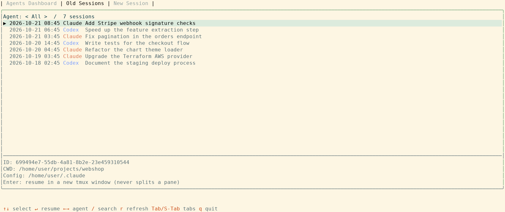
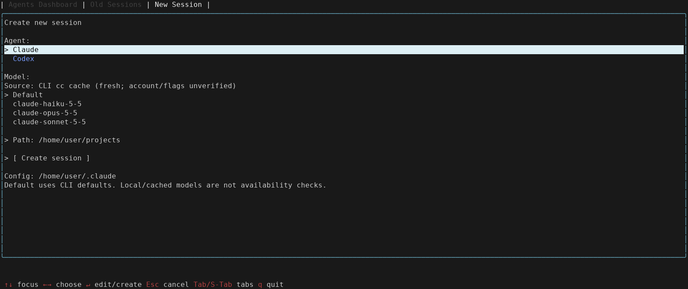

# agents-dashboard

**A terminal dashboard for your AI coding agents.** Watch live Claude Code, Codex CLI, and OpenCode sessions, follow their recent conversation, and resume or start sessions in a new tmux window — all from one screen.

This project is a fork of [graykode/abtop](https://github.com/graykode/abtop) (MIT). The binary is named `agents-dashboard`; the library crate keeps the name `abtop` for compatibility.



> Screenshots use the built-in demo data (`agents-dashboard --demo`), the default dark `btop` theme, and fixture sessions with anonymized paths.

## Features

- **Live sessions** for Claude Code, Codex CLI, and OpenCode: status (`Working`, `Reply`, `Wait`, `Done`), model, context window %, and token totals. A session that is waiting for your answer or a permission decision is flagged `Reply`.
- **Quota panel** with the Claude and Codex 5-hour and 7-day windows.
- **Chat history** for the selected session: recent user and assistant messages plus the tool calls and results between them, read-only, bounded, and redacted.
- **Session Archive**: browse past Claude and Codex sessions and resume one in a new tmux window.
- **New Session**: choose an agent, a model, and a path, then start it in a new tmux window.
- **Terminal jump**: `Enter` focuses the terminal running the selected session (cmux, tmux, iTerm2).
- 12 themes (including colorblind-friendly ones), a JSON snapshot for scripts, and a small library API.

Everything is read from local files and process metadata. No API keys, no authentication.

## Install

Requirements:

| Requirement | Needed for |
| --- | --- |
| Rust 1.88 or newer | Building from source |
| `tmux` | Session Archive, New Session, and tmux terminal jump |
| `claude` and/or `codex` on `PATH` | Starting or resuming sessions from the dashboard; `ocx` (OpenCodex) is optional and preferred for Claude when present (see [Launching sessions](#launching-sessions)) |
| `sqlite3` | OpenCode session discovery on Linux |
| `jq` | The optional Claude `Reply` hook (see [Reply detection](#reply-detection-for-claude-permission-prompts)) |

Build and install from source:

```bash
git clone https://github.com/ahnchiwan/agents-dashboard.git
cd agents-dashboard
cargo install --path .
```

Notes:

- This fork has no prebuilt binaries, crates.io releases, or Homebrew formula; build it from source as above. The upstream installer scripts and `cargo install abtop` install the original `abtop`, not this fork.
- To update, run `git pull` and `cargo install --path .` again in your checkout. `agents-dashboard --update` only prints these steps; it downloads and runs nothing.
- This fork is developed for use in WSL2 (Linux). macOS is expected to work but has not been verified. Native Windows is not supported; use WSL2 on Windows.

## Quick start

1. **Start tmux and run the dashboard inside it.** The live dashboard can run outside tmux, but Session Archive and New Session open sessions in a new window of the dashboard's own tmux session and report an error when it runs outside tmux.

   ```bash
   tmux new -s work
   agents-dashboard
   ```

   Press `t` to change the theme (the choice is saved), or use `--theme <name>` for a single run. New Session's Path starts at the directory you launch from, so start the dashboard from your projects directory. To try the UI without real sessions, run `agents-dashboard --demo`.

2. **Turn on Claude quota collection (once).** Claude Code does not write its rate limits to disk, so the quota panel shows `CLAUDE — no data · agents-dashboard --setup` until you run:

   ```bash
   agents-dashboard --setup
   ```

   This writes `abtop-statusline.sh` (requires `python3`) to your Claude config directory (`$CLAUDE_CONFIG_DIR`, or `~/.claude`) and sets it as the `statusLine` command in that directory's `settings.json`. The script saves the rate limits to `abtop-rate-limits.json` after each Claude response. Restart running Claude sessions to activate it. If `settings.json` already has a different `statusLine` command, `--setup` still writes the script but leaves `settings.json` unchanged and exits with an error, because Claude Code runs only one status line; remove that key and rerun, or call the script from your own status line script instead. Codex quota needs no setup: it is read from Codex's own session files after Codex has run once.

3. **Enable `Reply` for Claude permission prompts** with `agents-dashboard --setup-reply`, then restart Claude Code. This preserves existing hooks, StatusLine, and permission rules, and backs up changed settings. Codex permission prompts in tmux are detected automatically from its `Action Required` title; keep the default `activity` title item enabled. See [Reply detection](#reply-detection-for-claude-permission-prompts).

4. **Use the tabs.** Press `Tab` to move between **Agents Dashboard** (live sessions), **Session Archive** (resume with `Enter`), and **New Session** (pick agent, model, and path, then `Enter` on **Create session**). On a live session, `Enter` jumps to its terminal and `PgUp` / `PgDn` scroll its chat history. Press `?` for help and `q` to quit. All keys are listed in [Key bindings](#key-bindings).

## Usage

```bash
agents-dashboard                    # Launch the TUI
agents-dashboard --demo             # Launch with built-in sample data
agents-dashboard --once             # Print a snapshot with session summaries and exit
agents-dashboard --json             # Print one JSON snapshot and exit (for scripts/tools)
agents-dashboard --setup            # Install the Claude rate limit hook (see Quick start)
agents-dashboard --setup-reply      # Install Claude permission Reply hooks; preserve StatusLine
agents-dashboard --theme light      # Launch with a specific theme
agents-dashboard --mouse            # Enable mouse click/scroll navigation
agents-dashboard --no-mouse         # Disable mouse capture (the default)
agents-dashboard --exit-on-jump     # Quit after Enter-jumping to a session terminal
agents-dashboard --update           # Print how to update from source (no download)
agents-dashboard --version
```

Recommended terminal size: **120x40** or larger. Below 100 columns the dashboard switches to a compact layout with **Work** / **Usage** tabs; the minimum is 60x18.

Mouse capture is off by default so terminal drag selection and copy keep working. Launch with `--mouse` to enable tab clicks and wheel navigation. `--no-mouse` is also accepted; if both flags occur, the last one wins.

All themes apply to the Agents Dashboard tab and the tab header. Session Archive and New Session use fixed accent colors (green and blue borders, light selection rows) on every theme, and `t` works only in the Agents Dashboard tab.

## Tabs

The top-level tabs are **Agents Dashboard**, **Session Archive**, and **New Session**. Use `Tab` / `Shift+Tab` to cycle them (or click a tab when launched with `--mouse`). In compact mode, `←` / `→` select **Work** / **Usage** inside Agents Dashboard.

### Agents Dashboard

The sessions table shows one row per session: **AI**, **Status**, **Session Name**, **Model**, **Context**, and **Tokens**. `Working` covers thinking and running tools, `Reply` means the session is waiting for your answer or a permission decision, and `Wait` means it is idle. High quota usage does not change a session's status; usage is shown in the quota panel.

Under the selected session, the detail area shows a read-only chat history in transcript order. The collectors retain the latest 12 messages and at most 80 items per session; the title says `latest N items only` once older ones were dropped. The view wraps to the terminal width, has a scrollbar, and follows the newest item while it is at the bottom. `PgUp` scrolls up and keeps its place as new items arrive; `PgDn` or `End` returns to the bottom. `d` hides or shows the tool calls and results. The timeline (`l`) and file audit (`f`) views replace the chat area while active.

This is a compact activity view, not a terminal replica: it does not reproduce the live screen, colors, spinners, permission prompts, diffs, thinking text, or streamed partial output, and OpenCode sessions have no collected conversation. What the tool rows show:

- A call is one line: the tool name plus a single key argument (path, first line of a command, pattern, URL without its query string, or a short description). File contents, patches, and prompts passed to tools are never read.
- Results of shell commands (Claude `Bash`/`BashOutput`; Codex `exec_command`, `shell`, `write_stdin`, ...) show at most the first 8 lines (200 characters per line), followed by `… N more lines`. A failed Claude result is marked as an error; a non-zero Codex exit code is shown as `exit code N`.
- Results of every other tool (file reads, searches, web fetches, subagent replies, patches, MCP and unknown tools) show only a size summary such as `42 lines, 1.3 KB · content hidden`.
- Everything shown is terminal-sanitized and passed through secret redaction (known token prefixes only).
- Codex rollouts that use the newer `item_completed` schema show tool calls only (operation and path), because the collector deliberately reads no command text or output from that schema.

### Session Archive



Lists historical Claude and Codex main sessions, newest transcript modification first. Live sessions are excluded. Use `/` to search titles, IDs, working directories, or config roots (`Enter` accepts the search, `Esc` clears it), `←` / `→` to cycle the All / Claude / Codex filter, `↑` / `↓` to select, and `r` to refresh in the background.

`Enter` opens a **new window in the dashboard's current tmux session** and resumes the selected session there (`claude --resume ID` or `codex resume ID -C CWD`). It never splits a pane. The original working directory is used when it still exists. If it was moved, renamed, or deleted, the dashboard opens a **New path** input: edit the path with typing and `Backspace`, then press `Enter` to resume in that directory. Absolute paths and `~/...` are accepted; the directory must exist. `Esc` or switching tabs cancels without launching. The chosen path applies only to this launch and does not rewrite the archived session metadata. The session ID and original config root (`CLAUDE_CONFIG_DIR` / `CODEX_HOME`) are always retained. A missing config root, an unavailable executable, or running outside tmux produces an error instead of silently choosing another profile or directory. For Claude, resuming a session outside its original project requires a CLI version that supports cross-project session-ID lookup (v2.1.223 or newer).

History is scanned when you first enter Session Archive or New Session and is cached separately. It is never added to live token totals, quota, summaries, or JSON snapshots. Discovery reads Claude `projects/*/*.jsonl` and Codex `sessions/YYYY/MM/DD/rollout-*.jsonl`, excluding subagents. Each transcript is sampled at its first and last 64 KiB, and discovery examines at most 100,000 directory entries and parses the newest 20,000 files; the UI indicates when a limit is reached. Helper sessions such as title generators are hidden.

### New Session



Choose Claude or Codex, a model, and a path, then focus **Create session** and press `Enter`. Path starts at the directory the dashboard was launched from (or your home directory if that is unavailable); history refreshes never replace it. Use `↑` / `↓` to move between fields and `←` / `→` to change a selection. On Path, `Enter` starts editing, and while editing `Enter` accepts and `Esc` restores the previous path; absolute paths and `~/...` are supported. `Esc` outside path editing cancels the form. Only `Enter` on **Create session** launches the CLI (it is disabled in `--demo`).

**Default** is always offered and omits the model option. There is no free-text model entry and no assumed list of latest models. Choices come from bounded local reads, not availability checks, so treat them as hints rather than a promise of `/model` parity. New sessions use the dashboard's `CLAUDE_CONFIG_DIR` / `CODEX_HOME`, or the CLI's default home root when unset; the root must already exist.

#### Claude model catalog

Claude choices combine the `model` setting and the model environment variables (`ANTHROPIC_MODEL` and `ANTHROPIC_DEFAULT_{OPUS,SONNET,HAIKU}_MODEL`) with one catalog, chosen by the effective local context. The settings layers inspected are the root `settings.json`, the selected Path's `.claude/settings.json`, then `.claude/settings.local.json`; their environment entries override inherited values.

| Execution context | Catalog source |
| --- | --- |
| Custom nonempty `ANTHROPIC_BASE_URL` | Only `cache/gateway-models.json` with a matching provider URL (trailing slashes ignored) |
| No or empty base URL, OpenCodex proxy running | Only `cache/gateway-models.json` whose provider URL matches `http://127.0.0.1:<port>`, with `<port>` read from `~/.opencodex/runtime-port.json`; the stock catalog is not merged |
| No or empty base URL (proxy not found or cache mismatch), or `https://api.anthropic.com` | Newest valid `cache/model-catalog/*-cc.json` snapshot; never a union of accounts |
| Bedrock / Vertex / Foundry mode (`1` or `true`) | Configured choices only |

Gateway rows stay available regardless of age; the 24-hour threshold only labels them stale. Malformed catalogs, provider mismatches, and negative, future, or malformed `fetchedAt` values are rejected. A missing or rejected catalog falls back to the configured models plus Default. Only model IDs are read, reads are capped at 2 MiB per file, and no endpoint is called to validate a choice. From `~/.opencodex/runtime-port.json` only the `port` field is used. Codex uses the `model` literal in `config.toml` and the visible entries of `models_cache.json`. The form shows the source and freshness without exposing provider URLs.

### Launching sessions

Claude sessions, both new and resumed, start with `ocx claude` when an `ocx` executable is on `PATH`, so the OpenCodex proxy routing applies; otherwise they start with plain `claude`. Executables are resolved from `PATH` (never a shell function or alias), and launching fails with an error only if neither is found. The fallback is silent: if `ocx` is missing, a model that only the OpenCodex proxy understands (such as an `ocx-...` ID from the proxy's gateway catalog) will be rejected by plain `claude`. Codex is launched directly.

Windows are named exactly **Claude** or **Codex**, with automatic and application-driven renaming disabled. The launcher forwards the dashboard's model and provider environment as literal `env` arguments (and unsets missing keys) instead of relying on the tmux server's older environment. Launch arguments are passed separately and never interpolated into a shell command; tmux command separators and working-directory format expansion are escaped.

## Supported agents

| Feature           | Claude Code | Codex CLI | OpenCode |
| ----------------- | :---------: | :-------: | :------: |
| Session discovery |     ✅      |    ✅     |    ✅    |
| Token tracking    |     ✅      |    ✅     |    ✅    |
| Context window %  |     ✅      |    ✅     |    ❌    |
| Status detection  |     ✅      |    ✅     |    ✅    |
| Rate limit        |     ✅      |    ✅     |    ❌    |
| Chat history      |     ✅      |    ✅     |    ❌    |
| Old / New Session |     ✅      |    ✅     |    ❌    |
| Subagents         |     ✅      |    ❌     |    ❌    |

OpenCode support reads the local SQLite database at `~/.local/share/opencode/opencode.db` and requires `sqlite3` in `PATH`.

### Reply detection for Claude permission prompts

A Claude session that asks you a question (`AskUserQuestion`) is detected from its transcript. A **permission prompt** is not recorded in the transcript, so it needs an optional hook that leaves a small marker file while the prompt is open. The hook script is [`scripts/claude-reply-hook.sh`](scripts/claude-reply-hook.sh) and requires `bash` and `jq`.

Run `agents-dashboard --setup-reply` to install the hook in `$CLAUDE_CONFIG_DIR` or `~/.claude`, then restart Claude Code. The installer merges its hooks with existing entries, preserves StatusLine and permission rules, saves a private backup before changing settings, and can be run again without adding duplicate hooks. The hook only records status; it never grants or denies permission.

For a manual installation, copy it to `~/.claude/abtop-reply-hook.sh` and register it in `~/.claude/settings.json`, replacing `/home/you` with your home directory:

```json
{
  "hooks": {
    "PermissionRequest": [{ "hooks": [{ "type": "command", "command": "bash /home/you/.claude/abtop-reply-hook.sh mark" }] }],
    "Notification": [{ "matcher": "permission_prompt", "hooks": [{ "type": "command", "command": "bash /home/you/.claude/abtop-reply-hook.sh mark" }] }],
    "PostToolUse": [{ "hooks": [{ "type": "command", "command": "bash /home/you/.claude/abtop-reply-hook.sh clear" }] }],
    "PostToolUseFailure": [{ "hooks": [{ "type": "command", "command": "bash /home/you/.claude/abtop-reply-hook.sh clear" }] }],
    "PermissionDenied": [{ "hooks": [{ "type": "command", "command": "bash /home/you/.claude/abtop-reply-hook.sh clear" }] }],
    "SessionEnd": [{ "hooks": [{ "type": "command", "command": "bash /home/you/.claude/abtop-reply-hook.sh clear_all" }] }]
  }
}
```

Markers are written to `${CLAUDE_CONFIG_DIR:-~/.claude}/abtop-reply-state/<session_id>` and contain only the tool name, event kind, timestamps, and tool-use ID. `agents-dashboard --setup` separately installs the StatusLine hook that records Claude rate limits.

Codex's `request_permissions` and question tools also show `Reply` until their result arrives or the turn is cancelled. Command and file-edit approvals are detected in tmux from the owning client's `Action Required` title, including both blinking phases. They return to the transcript-derived status when the prompt closes, without waiting for the approved command to finish. Keep `activity` in Codex's terminal title (the default) for this signal; it is unavailable in terminals outside tmux or when that title item is disabled. Only title metadata is read, not the terminal's conversation or prompt contents.

## Terminal jump

Press `Enter` on a live session to focus the terminal that runs it. cmux, tmux, and iTerm2 on macOS are supported.

For tmux jumps, run both the dashboard and the agent inside tmux. A session in an ordinary terminal outside these supported backends cannot be focused with `Enter`.

Newer Codex clients can share an app-server that writes their transcripts. The dashboard matches each terminal client using its current tmux thread title or an explicit resume session ID, so multiple sessions can use the same working directory. Keep `thread-name` (included by default) or `session-id` in Codex's terminal title; duplicate names require `session-id` to distinguish them. Closing a client removes its dashboard entry even if the shared server retains the transcript. Live sessions are excluded from Session Archive.

```bash
tmux new -s work
# pane 0: agents-dashboard
# pane 1: claude (project A)
# pane 2: claude (project B)
# → Enter on a session in agents-dashboard jumps to its pane
```

## Themes

12 built-in themes: `btop` (default), `dracula`, `catppuccin`, `tokyo-night`, `gruvbox`, `nord`, `light`, `white`, and the colorblind-friendly `high-contrast`, `protanopia`, `deuteranopia`, and `tritanopia`. Press `t` to cycle at runtime; that choice is saved to `~/.config/agents-dashboard/config.toml`. `--theme <name>` overrides the theme for one run without saving it.

## Configuration

`~/.config/agents-dashboard/config.toml` supports:

```toml
theme = "btop"
# Hide specific agent CLIs from the TUI (case-insensitive).
hidden_agents = ["codex"]
# Additional Claude Code profile roots to scan.
# ~/.claude and ~/.claude-* roots that contain both sessions/ and projects/
# are discovered automatically.
claude_config_dirs = ["~/.claude-personal", "~/.claude-work-team"]
# UI language: "en" (default) or "zh". Omit to auto-detect from LANG.
language = "en"
```

When `language` is unset, any `LANG` starting with `zh` selects Simplified Chinese; otherwise English is used.

## Key bindings

| Key                 | Action                                                                 |
| ------------------- | ---------------------------------------------------------------------- |
| `Tab` / `Shift+Tab` | Next / previous top-level tab                                          |
| `←` / `→`           | Compact Work/Usage, archive agent filter, or form selection            |
| `↑` / `↓`, `k` / `j` | Select a live or historical session (`↑` / `↓` focuses form fields)   |
| `Enter`             | Focus the live terminal, resume history, or activate the focused form field/button |
| `/`                 | Search live or historical sessions                                     |
| `PgUp` / `PgDn`     | Scroll the selected session's chat history                             |
| `End`               | Jump to the newest chat item and follow new ones                       |
| `d`                 | Show / hide tool calls and results in the chat history                 |
| `l` / `f`           | Timeline / file audit view                                             |
| `x`                 | Kill the selected live session                                         |
| `t`                 | Cycle theme                                                            |
| `1` / `2`           | Toggle the quota / sessions panels                                     |
| `v` / `?`           | View menu / help                                                       |
| `Esc`               | Clear search or cancel path edit/form                                  |
| `r`                 | Refresh live data or the historical scan                               |
| `q`                 | Quit (except during text entry)                                        |

## Library and JSON snapshot

The library crate is named `abtop`, so local tools can reuse the data-collection layer in-process and serialize the same state the TUI renders.

```bash
agents-dashboard --json    # one-shot JSON snapshot for scripts
```

For long-running consumers, build an `App`, refresh it with `App::tick_no_summaries()` (which never spawns `claude --print`), and call `App::to_snapshot(interval_ms)` to get a JSON-serializable `Snapshot`:

```rust,no_run
use abtop::app::App;
use abtop::{config, theme::Theme};

let cfg = config::load_config();
let mut app = App::new_with_config_and_claude_dirs(
    Theme::default(), &cfg.hidden_agents, cfg.panels, &cfg.claude_config_dirs,
);
app.tick_no_summaries();
let json = serde_json::to_string(&app.to_snapshot(2_000)).unwrap();
```

`App` is not `Send` (it owns the collectors), so keep it on one thread and pass the serialized JSON elsewhere.

## Privacy

agents-dashboard reads local files and local process/open-file metadata only. In the TUI and `--once` output, tool names and file paths are shown, but file contents and prompt text are not. The one exception is the chat history: it shows the first lines of shell command output (see above), which can include whatever the command printed, such as file text from `cat`. Press `d` to hide all tool rows. Only `--once` generates session summaries, with `claude --print`, which makes its own API call; this is the only indirect network usage. The TUI and `--json` never spawn it and use previously cached summaries or the first prompt instead.

The JSON snapshot includes richer local data: `summary`, `chat_messages` (user and assistant messages only; tool call and result rows are never serialized), working directories, config roots, tool-call previews, child process commands, token counts, and port metadata. Chat text is bounded and redacted, but it comes from local transcripts and may contain sensitive project context. Treat JSON snapshots as private and do not write them to shared logs or expose them on a network without your own access controls.

## Acknowledgements

This project builds on [abtop](https://github.com/graykode/abtop) by Tae Hwan Jung (graykode) and its contributors. Thanks to [@tbouquet](https://github.com/tbouquet) for much of upstream's recent shape — themes, config overlay and panel toggles, session filtering, the subagent tree view, the context window gauge, and a steady stream of fixes and security hardening.

## License

MIT. See [LICENSE](LICENSE).
